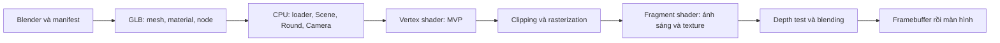

# 0. Bắt đầu: từ máy gắp đến hình ảnh trên màn hình

## 0.1. Chương trình đang mô phỏng điều gì?

CLAW LAB là một máy gắp 3D có tủ, ray trượt, trolley (xe con chạy trên ray), dây nâng, đầu gắp, ba ngón và tám vật phẩm hình capsule có đường may. Vật phẩm là mẫu trung tính, chưa phải một nhân vật thú bông hoàn chỉnh. Người chơi căn càng, bắt đầu lượt, theo dõi hạ–khép–nâng–về cửa–thả. Có thể trúng hoặc hụt.

Từ “mô phỏng” ở đây cần hiểu theo mức độ: chương trình điều khiển chuyển động bằng quy tắc, không giải lực tiếp xúc giữa vải và kim loại. Bắt trúng dựa trên khoảng cách và độ cao. Đường trong chute được định sẵn. Chúng tạo ra trò chơi lặp lại được, nhưng không chứng minh tính cơ học của một máy thật.

## 0.2. Những khái niệm toán đầu tiên

Một **điểm** cho biết vị trí. Trong không gian 3D, ta viết `(x,y,z)`: chẳng hạn `(0,1,0)` cao một mét trên gốc nếu trục Y hướng lên. Một **vector** mô tả hướng và độ lớn; vector từ A tới B bằng `B − A`. Điểm có vị trí tuyệt đối trong hệ đang xét; vector dịch chuyển có thể đặt ở nhiều vị trí mà vẫn biểu diễn cùng hướng/độ dài.

Độ dài vector `v=(x,y,z)` là `sqrt(x²+y²+z²)`. **Chuẩn hóa** chia vector cho độ dài để nhận vector đơn vị. Không chuẩn hóa vector không vì phép chia không xác định.

**Tích vô hướng** `a·b=ax*bx+ay*by+az*bz` liên hệ với góc: nếu a và b đơn vị thì `a·b=cos(theta)`. Hai hướng cùng chiều cho 1; vuông góc cho 0. Công thức ánh sáng dùng quan hệ này để biết mặt có hướng về đèn không.

**Tích có hướng** `a×b` tạo vector vuông góc với cả a và b. Độ lớn phụ thuộc diện tích hình bình hành do a và b tạo ra. Đổi thứ tự thành `b×a` thì đổi dấu; vì vậy thứ tự đỉnh tam giác ảnh hưởng hướng pháp tuyến mặt.

**Ma trận** là một bảng số dùng để biến đổi vector. Với quy ước vector cột trong dự án, `M*p` nghĩa là áp dụng M lên p. `A*B*p` áp dụng B trước rồi A. Đừng suy thứ tự tính từ trái sang phải như một chuỗi thao tác bằng lời.

## 0.3. Ai làm công việc gì?

CPU chạy C++: nhận input, cập nhật trạng thái game, tính camera và transform, đọc asset rồi gửi dữ liệu/lệnh sang GPU. GPU chạy shader để biến đổi đỉnh, tạo fragment, tính màu và xử lý depth/blend. **Fragment** là ứng viên đóng góp vào một mẫu ảnh; không nên đồng nhất nó tuyệt đối với “một pixel cuối cùng”, nhất là khi multisampling hoặc depth test loại nó.

Sơ đồ diễn tả dòng dữ liệu khái niệm. GPU có thể tối ưu thứ tự một số kiểm tra, ví dụ early depth test; không nên coi sơ đồ là cam kết lịch thực thi từng fragment. Shadow mapping còn có lượt dựng depth từ phía đèn trước lượt camera.

**Shader** là chương trình nhỏ chạy trên GPU. `lit.vert` chạy cho các đỉnh; `lit.frag` tính màu từ dữ liệu đã nội suy trên tam giác. `uniform` là dữ liệu CPU đặt cho một draw call, như ma trận camera. `in`/`out` nối dữ liệu giữa các giai đoạn. GPU nội suy normal/UV không có nghĩa normal đã có độ dài 1; fragment shader vẫn chuẩn hóa lại.

## 0.4. Bản đồ mã nguồn

- [src/core.h](../src/core.h) khai báo dữ liệu; [src/core.cpp](../src/core.cpp) thực hiện `localMatrix`, `Scene::worldMatrix`, `Camera`, `Round`, `FixedClock`, `chooseCandidate`, `applyPose`.
- [GltfLoader.cpp](../src/assets/GltfLoader.cpp) chuyển dữ liệu glTF thành dữ liệu ứng dụng. [GltfLoader.h](../src/assets/GltfLoader.h) định nghĩa `Vertex`, `Mesh`, `Material`, `SceneAsset`.
- [Renderer.cpp](../src/graphics/Renderer.cpp) tạo tài nguyên GPU, đặt render state và gửi draw calls. [lit.vert](../shaders/lit.vert), [lit.frag](../shaders/lit.frag), [depth.vert](../shaders/depth.vert), [depth.frag](../shaders/depth.frag) là shader của dự án.
- [main.cpp](../src/main.cpp) tạo cửa sổ/context, lặp frame, nhận input, gọi simulation rồi renderer và vẽ controls.
- [build_reference.py](../mockups/build_reference.py) dựng nguồn Blender; [export_assets.py](../tools/export_assets.py) xuất GLB. Chúng không chạy trong mỗi frame game.

## 0.5. Cách học mỗi phần

Đọc một mục, tự dự đoán một hiện tượng rồi mới chạy thử. Ví dụ: nếu quay parent 90° quanh Y, child cách parent một mét theo X sẽ đi đâu? Nếu tắt depth write của kính nhưng vẫn giữ depth test thì vật sau kính có bị loại không? Nếu tăng thời lượng hạ, tốc độ hạ sẽ thay đổi ra sao?

Sau đó mở đúng hàm/shader, tìm biến quyết định hiện tượng. Cuối cùng nói lại bằng một ví dụ số. Nếu chỉ nhớ tên kỹ thuật mà không giải thích được đầu vào, phép tính và đầu ra, cần quay lại ví dụ nhỏ trước khi học thêm hiệu ứng.

Đọc tiếp: [1. Hình học và biến đổi](01-hinh-hoc-va-bien-doi.md). Tra [nguồn sơ cấp](06-dac-ta-va-tham-khao.md) khi cần định nghĩa chi tiết hơn.
