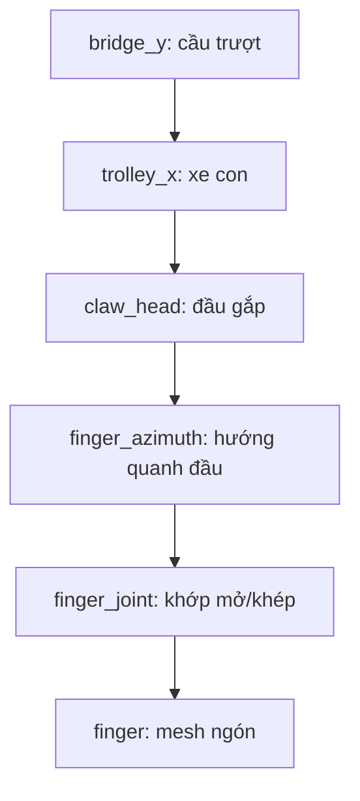

# 1. Người 1 — Hình học 3D và phép biến đổi

Mục tiêu: giải thích máy được biểu diễn bằng dữ liệu gì, vì sao một bộ phận di chuyển đúng theo bộ phận khác và ngón gắp cong được tạo ra thế nào. Thứ tự là mesh → biến đổi → phân cấp → Bézier, như bản phân công.

## 1.1. Hình học 3D và mesh

### 1.1.1. Từ hình khối đến tam giác

Máy trông như các khối đặc, nhưng GPU nhận các bề mặt ghép từ tam giác. **Vertex** là đỉnh chứa ít nhất vị trí; trong dự án, một đỉnh còn có normal và UV. **Edge** là cạnh nối hai đỉnh. **Face** là một mặt; mô hình authoring có thể dùng đa giác, còn loader runtime chỉ nhận primitive tam giác.

Một mặt hộp có bốn góc A, B, C, D có thể chia thành hai tam giác ABC và ACD. Hộp có sáu mặt thường được vẽ bằng 12 tam giác. Tuy nhiên không được kết luận “hộp luôn có tám vertex trong GPU”: góc chung của ba mặt cần các normal khác nhau để giữ cạnh sắc, nên dữ liệu vertex thường phải tách. UV seam cũng có thể gây tách vertex dù vị trí trùng nhau.

**Mesh** là tập dữ liệu bề mặt gồm đỉnh và liên kết tạo mặt. **Index buffer** ghi số thứ tự đỉnh cho mỗi tam giác thay vì lặp toàn bộ thuộc tính của từng đỉnh. Ví dụ indices `[0,1,2, 0,2,3]` biểu diễn hai tam giác dùng chung các đỉnh 0 và 2.

### 1.1.2. Gắn với bộ phận máy

Trong [build_reference.py](../mockups/build_reference.py), tìm `cube`, `cylinder`, `sphere`, `curve`:

- Tủ, console, sàn khoang và khay nhận bắt đầu từ hộp, được bevel để bo cạnh.
- Ray, chốt và thân đầu gắp dùng trụ; capsule dùng một mặt cầu được co giãn thành kích thước thiết kế.
- Ngón gắp và đường may dùng curve có độ dày. Curve phải được chuyển thành mesh trước khi xuất runtime.
- Chữ trên tủ cũng được chuyển thành hình học. Chữ này thuộc máy, khác với controls Dear ImGui được vẽ sau cảnh 3D.

Tìm `new_from_object` trong [export_assets.py](../tools/export_assets.py): geometry đã evaluate, gồm kết quả modifier, được chuyển thành mesh. Vì vậy runtime nhận hình bo cạnh thật chứ không tự bevel bằng C++.

### 1.1.3. Normal là gì và dùng để làm gì?

**Pháp tuyến** là hướng vuông góc bề mặt, dùng để tính ánh sáng. Với tam giác ABC không suy biến, normal mặt có thể tính từ `normalize((B−A)×(C−A))`. Normal của vertex có thể được làm mượt giữa các mặt, giúp hình cầu trông trơn dù hình học vẫn hữu hạn tam giác.

Đừng nhầm normal với vị trí: vị trí trả lời “điểm nằm đâu”, normal trả lời “mặt hướng về đâu”. Thay normal có thể làm bề mặt sáng khác nhưng không đổi silhouette. Muốn đường viền cong mịn hơn phải có đủ geometry, không chỉ bật smooth shading.

Trong dự án, normals đến từ asset Blender. [GltfLoader.cpp](../src/assets/GltfLoader.cpp), hàm `GltfLoader::load`, đọc `POSITION`, `NORMAL`, `TEXCOORD_0`. Renderer gửi ba thuộc tính qua location 0, 1, 2. `glDrawElements(GL_TRIANGLES,...)` yêu cầu GPU dựng các tam giác từ indices. Dự án không dùng `glBegin` hoặc hệ ma trận legacy.

### 1.1.4. Mesh khác instance thế nào?

Mesh là khuôn dữ liệu; **instance** là một lần sử dụng khuôn đó với transform và danh tính riêng. Tám capsule không cần tám thiết kế: node `prize_01`…`prize_08` có vị trí/yaw khác nhau nhưng các phần volume, seam, stitch chia sẻ mesh tương ứng. Ba ngón gắp cũng dùng chung mesh ngón.

Trong [GltfLoader.h](../src/assets/GltfLoader.h), `SceneAsset` giữ danh sách `meshes`, còn `Node::mesh` là chỉ số tham chiếu. Renderer nạp một bộ GPU buffers cho mỗi mesh rồi vẽ lại bằng các world matrix khác nhau. Đây là tái sử dụng mesh; code chưa dùng một lệnh `glDrawElementsInstanced` cho cả nhóm, nên không gọi nó là hardware instancing.

Vật phẩm được nâng vẫn là chính `PrizeState` có ID đã chọn. Không sinh một “vật phẩm cầm trên càng” khác rồi đổi hình khi tới khay. Đây là bất biến danh tính xuyên suốt gameplay, không chỉ yêu cầu thẩm mỹ.

**Tự kiểm:** tăng số lượng instance làm tăng số mesh hay số node? Với cách chia sẻ hiện tại, chỉ thêm instance/transform nếu hình học không đổi; số draw calls vẫn có thể tăng.

## 1.2. Tịnh tiến, quay và co giãn

### 1.2.1. Tọa độ thuần nhất và tịnh tiến

Ma trận 3×3 có thể quay/co giãn vector 3D nhưng không biểu diễn tịnh tiến theo cùng phép nhân tuyến tính. Ta thêm tọa độ thứ tư: điểm là `(x,y,z,1)`, hướng là `(x,y,z,0)`. Ma trận 4×4 giúp ghép tịnh tiến với quay và scale.

```text
T(tx,ty,tz) = [ 1 0 0 tx ]
              [ 0 1 0 ty ]
              [ 0 0 1 tz ]
              [ 0 0 0  1 ]
```

`T*(1,0,0,1)` với `tx=2` cho điểm `(3,0,0,1)`. Nếu nhân hướng có w=0, tx không tác động: chuyển cả vật thể sang vị trí khác không làm hướng “phải” tự đổi chiều.

### 1.2.2. Quay và scale

Scale `(sx,sy,sz)` nhân các tọa độ tương ứng. Trong game, dây nâng thay chiều dài bằng scale trên Y runtime, đồng thời dịch tâm để nối đúng đầu gắp với trolley. Chỉ scale mà không dịch tâm sẽ làm hai đầu dây chạy sai vị trí.

Quay quanh trục cần cả góc và trục quay. Dự án lưu rotation bằng **quaternion**, rồi chuyển thành ma trận. Quaternion là cách biểu diễn phép quay 3D thuận tiện cho tổ hợp; không cần học thuộc bốn thành phần ngay, nhưng phải biết code tạo nó từ axis-angle bằng `glm::angleAxis`. Góc toán trong GLM là radian: 180° bằng pi radian. `glm::radians` chuyển độ từ thiết kế sang radian.

Ví dụ quay 90° quanh Y theo quy ước GLM dùng ở đây: điểm `(1,0,0)` thành gần `(0,0,−1)`. Sai số rất nhỏ quanh 0 do tính toán floating point không phải phép quay bị lệch có chủ đích.

### 1.2.3. Thứ tự nhân làm thay đổi kết quả

Tìm `localMatrix` trong [core.cpp](../src/core.cpp):

```cpp
return glm::translate(glm::mat4(1), t.translation) *
       glm::toMat4(t.rotation) * glm::scale(glm::mat4(1), t.scale);
```

Đó là `Mlocal=T*R*S`. Với vector cột, đỉnh chịu scale trước, quay sau, rồi tịnh tiến. Ví dụ p=(1,0,0), quay quanh Y 90° và dịch +2 theo X: `T*R*p` cho `(2,0,−1)`; `R*T*p` cho `(0,0,−3)`. Cùng hai phép toán nhưng khác thứ tự nên quỹ đạo khác nhau.

Không cần tự viết lại thư viện ma trận để chứng minh hiểu biến đổi. Cần giải thích vì sao chọn thứ tự này và chỉ được tới dữ liệu `Transform` đang được consumer sử dụng.

## 1.3. Local/world và biến đổi phân cấp

### 1.3.1. Một vị trí phải đi kèm hệ tọa độ

**Local space** gắn với một bộ phận. **World space** là hệ chung của cả cảnh. Điểm tại gốc local của ngón không nhất thiết ở gốc thế giới: ngón có parent là khớp; khớp thuộc đầu gắp; đầu gắp thuộc trolley.



Ba nhánh ngón có azimuth cách nhau 120°. Nếu trolley dịch sang phải thì toàn bộ đầu gắp, khớp và ngón đi theo. Nếu chỉ một joint quay thì các nhánh còn lại không đổi theo joint đó.

### 1.3.2. Công thức cha–con

`Mworld(child)=Mworld(parent)*Mlocal(child)`. Hàm `Scene::worldMatrix` bắt đầu từ local của node rồi nhân các parent dọc chuỗi. Nó kiểm chỉ số và phát hiện chuỗi parent vòng lặp để tránh đi vô hạn.

Khớp có một vị trí pivot ở parent. Mesh ngón được dựng tương đối với khớp; quay joint khiến các điểm của ngón quay quanh gốc joint. Nếu dựng mesh ở world rồi quay quanh world origin, ngón sẽ văng quanh máy thay vì khép quanh khớp. Với một pivot tùy ý p trong cùng hệ, có thể diễn đạt phép quay là `T(p)*R*T(−p)`; scene graph đã tách các bước này vào hierarchy.

### 1.3.3. Đổi trục một lần

Blender authoring dùng Z-up, phía trước là −Y. Runtime glTF dùng Y-up. Dữ liệu từ manifest đổi bằng `(x,y,z)→(x,z,−y)` trong `fromAuthoring`. Geometry glTF đã được exporter đổi trục, nên loader không đổi nó lần nữa.

Tên `bridge_y` là tên theo authoring: dịch theo Y Blender tương ứng Z runtime. `applyPose` đặt `bridge_y.translation.z=s.aim.y`, trolley dịch theo X, còn đầu gắp thay `.translation.y`. Tên có chữ Y không chứng minh code đang dùng cùng Y ở cả hai hệ.

Ngón mở −22° theo authoring được áp vào rotation quanh Z runtime với dấu đổi phù hợp trong `applyPose`. Giải thích trục bằng phép ánh xạ, không nhớ máy móc “mọi rotation đều quanh Y”.

### 1.3.4. Thử nghiệm cho người trình bày

Chọn góc Trên, WASD để thấy hai phương ray; chọn góc chéo rồi Space để thấy chiều dọc và xoay joint. Mở `applyPose` và chỉ ba dòng điều khiển cầu, trolley, đầu gắp, sau đó vòng lặp ba joint. Test `parent rotation moves child around its pivot` ở [core_tests.cpp](../tests/core_tests.cpp) dùng một cấu hình nhỏ để kiểm phép tính độc lập hình đẹp.

## 1.4. Đường cong Bézier của ngón gắp

### 1.4.1. Vì sao dùng đường cong?

Một đoạn thẳng không tả được hình ngón uốn. Bézier cho phép thiết kế đường cong bằng một số điểm điều khiển. Tại mỗi t từ 0 đến 1, công thức trả một điểm trên đường. Nối các điểm lấy mẫu cho một polyline; thêm tiết diện tròn quanh đường tạo ống có độ dày.

Với Bézier bậc ba có bốn điểm P0…P3:

```text
B(t) = (1−t)^3 P0 + 3(1−t)^2 t P1 + 3(1−t)t^2 P2 + t^3 P3
0 ≤ t ≤ 1
```

P0 và P3 là hai đầu; P1 và P2 kéo hướng cong. Đường thường không đi qua P1/P2. B(0)=P0, B(1)=P3. Tiếp tuyến đầu là `3(P1−P0)`, cuối là `3(P3−P2)`.

### 1.4.2. Tính một điểm thật của dự án

[curve-control-points.json](../assets/design/curve-control-points.json) lưu hai đoạn bậc ba từ curve Blender. Đoạn đầu gần đúng:

```text
P0=(0, 0, 0)
P1=(0.027329, 0, −0.048801)
P2=(0.065995, 0, −0.069211)
P3=(0.070000, 0, −0.125000)
```

Tại t=0,5, các trọng số là 1/8, 3/8, 3/8, 1/8. Kết quả gần `(0.043747,0,−0.059880)` mét trong local authoring. Đây là phép thế số, không phải tọa độ world. Muốn hiển thị đúng phải đổi trục và áp hierarchy tương ứng.

### 1.4.3. Chính xác ai tính Bézier?

Trong `build_reference.py`, tìm `bezier=True`, `BEZIER`, `handle_left_type='AUTO'`, `handle_right_type='AUTO'`. Script cung cấp ba knot, Blender tính auto handles tạo hai đoạn bậc ba. Đừng gọi ba knot đó là “ba điểm điều khiển của một Bézier bậc hai”: mỗi đoạn có bốn điểm gồm hai knot và hai handles.

`export_assets.py` lấy tọa độ knot/handle thật vào JSON và chuyển curve evaluate thành mesh dùng chung. Runtime OpenGL vẽ mesh đã lấy mẫu; C++ không evaluate công thức Bézier mỗi frame. Khi đóng/mở, mesh ngón giữ nguyên; joint quay nó.

### 1.4.4. Học thêm và tự kiểm

Có thể dùng de Casteljau để tự tính B(t): nội suy P0–P1, P1–P2, P2–P3; nội suy tiếp các kết quả; cuối cùng nội suy lần nữa. Cách này giải thích hình học của trọng số mà không bắt đầu từ đa thức.

Hãy thử t=0; 0,5; 1 bằng máy tính, rồi so hai endpoint chung giữa hai đoạn trong JSON. Cùng endpoint chỉ bảo đảm liên tục vị trí C0. Muốn chuyển tiếp trơn còn cần xét hướng/độ lớn tiếp tuyến; không khẳng định C1/C2 chỉ vì nhìn “có vẻ trơn”. Lấy mẫu t đều cũng không bảo đảm khoảng cách đều theo độ dài cung.

Chuyển lời cho người 2: “Mình đã có bề mặt và vị trí world. Phần tiếp theo là camera và GPU biến chúng thành ảnh như thế nào.” Xem [2. Camera và dựng hình](02-camera-chieu-sang-dung-hinh.md).
