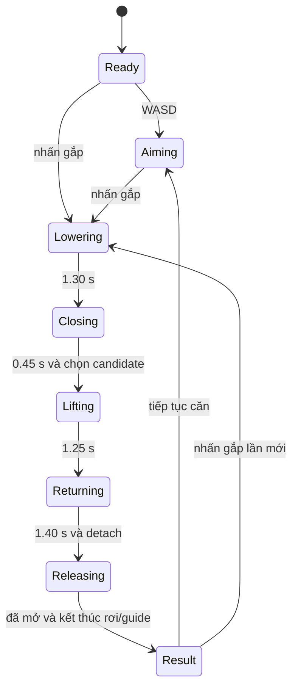

# 3. Người 3 — Texture, trong suốt và thuật toán tương tác

Mục tiêu: giải thích chi tiết bề mặt, kính và một lượt chơi hoàn chỉnh; sau đó học hai thuật toán 2D theo ảnh phân công. UV, blending và state machine có trong sản phẩm. Mục 3.4 là kiến thức mở rộng chưa được cài trong game.

## 3.1. Texture mapping

### 3.1.1. Vì sao cần UV?

Mesh định hình bề mặt, nhưng từng đường dệt nhỏ không nhất thiết phải là geometry. **Texture** là dữ liệu ảnh để shader tra cứu màu hoặc thuộc tính. **UV** là cặp tọa độ 2D gắn với mỗi vertex, cho biết vị trí trên ảnh tương ứng với điểm trên bề mặt.

Hình dung trải vỏ hộp thành một bản giấy phẳng: mỗi mặt hộp chiếm một vùng trên ảnh. UV seam là đường cắt khi trải; vị trí 3D tại đường cắt có thể cần hai vertex có UV khác nhau. Normal map là dữ liệu hướng giả lập chi tiết ánh sáng; nó không phải base-color texture và chưa được loader/shader hiện tại hỗ trợ như một pipeline normal mapping đầy đủ.

UV thường dùng miền [0,1], nhưng có thể nằm ngoài miền đó để lặp hoặc clamp theo sampler. Texel là phần tử của texture; pixel là phần tử ảnh đầu ra. Một texel có thể đóng góp vào nhiều pixel khi phóng to hoặc nhiều texel được lọc vào một pixel khi thu nhỏ.

### 3.1.2. Đường dữ liệu trong dự án

1. [export_assets.py](../tools/export_assets.py) tạo ảnh dệt dùng chung 512×512, gắn vào material `prize`, pack vào GLB. Đây là texture màu được tạo offline; không phải nhân vật mới cho từng instance.
2. [GltfLoader.cpp](../src/assets/GltfLoader.cpp) đọc `TEXCOORD_0`, image pixels và liên kết base-color texture của material. TinyGLTF/stb làm phần decode định dạng; adapter của dự án chuyển dữ liệu sang `SceneAsset`.
3. [Renderer.cpp](../src/graphics/Renderer.cpp) tạo texture GPU, đặt định dạng `GL_SRGB8` hoặc `GL_SRGB8_ALPHA8`, gửi UV vào vertex attribute 2 và bind ảnh tại texture unit 0.
4. [lit.vert](../shaders/lit.vert) chuyển UV ra fragment stage. [lit.frag](../shaders/lit.frag) lấy `texture(colorTexture,uv)` rồi nhân `baseColor` nếu `hasTexture`.

Tọa độ texture đã đi qua quy ước exporter/loader; không tự lật V ở một instance để “trông đúng” vì các consumer còn lại sẽ lệch. Nếu cần sửa quy ước, sửa tại đúng ranh giới chung và đối chiếu toàn asset.

### 3.1.3. Lọc, mipmap và sRGB

Với nearest, sample chọn một texel gần; với linear, GPU kết hợp các texel lân cận. Khi vật ở xa, nhiều texel co vào một pixel; mipmap lưu các phiên bản ảnh nhỏ dần để giảm nhiễu và aliasing. Code gọi `glGenerateMipmap`, dùng `GL_LINEAR_MIPMAP_LINEAR` khi thu nhỏ và `GL_LINEAR` khi phóng to; wrap S/T là `GL_REPEAT`.

Mipmap không sửa UV sai hay seam hở. Lọc tốt cũng không tạo thông tin vượt độ phân giải ảnh gốc. `GL_UNPACK_ALIGNMENT=1` giúp CPU chuyển hàng ảnh đúng byte alignment, đặc biệt RGB có độ rộng không chia hết cho 4.

Ảnh màu sRGB được decode sang tuyến tính khi sample, sau đó tính ánh sáng. Các texture dữ liệu như roughness hoặc normal nếu có không nên bị decode sRGB như màu. Pipeline hiện chỉ dùng base-color image của GLB; các field scalar roughness/metallic được đọc riêng.

**Demo:** nhìn cận vật phẩm bằng zoom, chỉ seam và stitch là mesh riêng, còn họa tiết dệt là texture. CLI `--no-texture` dùng cho A/B phát triển. Việc thấy đường may không tự chứng minh texture mapping vì đường may ở đây là geometry.

## 3.2. Alpha blending và kính

### 3.2.1. Alpha mô tả mức đóng góp màu

RGBA thêm alpha vào màu RGB. Với non-premultiplied source color và `glBlendFunc(GL_SRC_ALPHA,GL_ONE_MINUS_SRC_ALPHA)`, phép trộn RGB là:

```text
Cout = alpha_src * Csrc + (1−alpha_src) * Cdst
```

Csrc là fragment đang vẽ; Cdst là màu đã có trong framebuffer. Ví dụ kính màu `(0,8;0,9;1,0)`, alpha=0,1 trên nền `(0,2;0,4;0,6)` cho `(0,26;0,45;0,64)`. Dấu chấm phẩy ở đây phân cách ba thành phần; dấu phẩy là thập phân.

Alpha trong thiết kế kính là 0,065, nhưng shader tăng thêm một phần phụ thuộc góc nhìn để gợi Fresnel ở góc xiên. Đây là hiệu ứng thị giác xấp xỉ. Kính hiện không bẻ cong tia để mô phỏng refraction, không hấp thụ theo bề dày và không ray trace vật phía sau.

### 3.2.2. Vì sao thứ tự vẽ quan trọng?

Trộn màu không có tính giao hoán. Một lớp đỏ alpha 0,5 trên đen rồi xanh alpha 0,5 cho RGB `(0,25;0;0,5)`. Đảo lại cho `(0,5;0;0,25)`. Vì thế renderer vẽ vật đục trước, các primitive kính sau theo khoảng cách xa→gần.

Ở pass kính, depth test vẫn bật để khung đục che kính đúng; `glDepthMask(GL_FALSE)` tránh kính ghi depth gây loại sai lớp trong suốt phía sau. Khi xong, renderer bật lại depth write và tắt blending. Render state là trạng thái toàn context; quên phục hồi sẽ ảnh hưởng frame/pass kế tiếp.

### 3.2.3. Hiểu đúng giới hạn code

Sort hiện dùng vị trí gốc world của node, không sort từng tam giác hoặc theo từng pixel. Với các tấm kính lớn/cắt nhau, khoảng cách tâm có thể không đủ xác định thứ tự đúng ở mọi vùng. Muốn tổng quát hơn cần chia geometry hoặc order-independent transparency. Không tuyên bố “xa→gần giải quyết hoàn toàn kính”.

Shader xử lý ánh sáng ở miền tuyến tính nhưng encode RGB trước khi blending vào framebuffer thông thường. Vì vậy phép blend đang diễn ra trên màu display-encoded, chưa phải pipeline transparency tuyến tính nghiêm ngặt. Đây là một hướng nâng cấp thực tế: blend vào HDR/linear color target, sau cùng tone-map/encode một lần. Đừng mô tả bản hiện tại là kính vật lý chính xác.

Với cùng blend factors cho RGBA, phương trình alpha framebuffer không nhất thiết là phương trình compositing alpha chuẩn nếu muốn tái sử dụng alpha đầu ra. Bản game hiển thị lên cửa sổ đục, không xuất compositing layer trong suốt để ghép ảnh; công thức ở 3.2.1 đang giải thích **RGB**.

## 3.3. Hoạt hình, thời gian và state machine

### 3.3.1. Chuyển động theo thời gian, không theo số frame

Nếu mỗi frame dịch 1 cm, máy 144 fps chạy nhanh hơn máy 30 fps. Chuyển động tốc độ v phải dùng `deltaPosition=v*deltaTime`. Bản này tách số frame hiển thị khỏi mô phỏng: `FixedClock::steps` gom thời gian và trả số bước cố định 1/60 giây cần chạy.

Một frame 1/30 giây thường chạy hai simulation steps; một frame 1/144 giây có thể chưa đủ chạy bước nào. Accumulator mang phần dư sang frame sau. Tối đa năm substeps/frame và dt nhận vào tối đa 0,25 s để tránh **spiral of death**: máy chậm phải chạy quá nhiều simulation khiến càng chậm thêm. Khi quá tải, code bỏ backlog, nghĩa là simulation không cam kết bám thời gian thực vô hạn trong stall dài.

Mất focus tự pause và xóa backlog. `main.cpp` đợi focus ổn định trở lại rồi mới tiếp tục cập nhật. Renderer chỉ đọc snapshot, không tăng điểm hoặc lựa chọn vật phẩm. Không có thuật toán nội suy giữa hai snapshot riêng cho render trong code hiện tại; easing nằm ngay trong pose được cập nhật ở fixed tick.

### 3.3.2. Nội suy và easing

Từ A tới B trong thời lượng T, đặt `u=clamp(t/T,0,1)`. Nội suy tuyến tính là `A+(B−A)u`. Code dùng smoothstep đa thức `e(u)=u²(3−2u)` rồi nội suy theo e, làm tốc độ về 0 ở hai đầu.

Hạ từ 1,46 m tới 1,00 m trong 1,30 s: tại t=0,65 s, u=0,5, e=0,5, đầu gắp ở 1,23 m. Easing làm chuyển động bớt giật nhưng không là một mô hình lực/động cơ. Không đồng nhất “trơn theo thời gian” với “đúng vật lý”.

### 3.3.3. Máy trạng thái quản lý lượt



Trong `Round::advance`, chỉ Ready/Aiming nhận steering. Ready có thể bắt đầu gắp ngay mà không cần đi qua Aiming. Result có thể trở lại Ready nội bộ rồi xử lý input trong cùng tick; sơ đồ gộp chuyển tiếp đó cho dễ đọc. Mở càng có thời lượng 0,55 s, nhưng Release còn chờ rơi/guide hoàn tất, không phải cứ 0,55 s là chắc chắn tính điểm.

Reset ở mọi trạng thái khôi phục tám vật phẩm, điểm/lượt về 0, bỏ held/falling và clock. Camera giữ góc hiện tại. Giữ Space không tạo lượt lặp vì `edge=grab&&!lastGrab_`; nút UI/nhấn nhanh còn được main giữ qua `pendingGrab` để không mất giữa hai tick.

### 3.3.4. Quy tắc bắt và giữ vật phẩm

Grip anchor nằm dưới đầu gắp 0,238 m. Ở headY=1,00 m, anchorY=0,762 m, bằng tâm capsule đang nằm trên sàn 0,70 m với nửa chiều cao 0,062 m. `chooseCandidate` chỉ xét vật chưa delivered, độ lệch cao không quá 0,035 m và khoảng cách ngang không quá 0,045 m. Gần nhất thắng, tie gần bằng nhau theo ID để kết quả ổn định; không RNG.

Khi bắt, code lưu `gripLocal = prizePosition − headPosition`, rồi mỗi tick dùng `prizePosition=headPosition+gripLocal`. Vật không bị snap về tâm càng. Đây là offset tịnh tiến: đầu gắp không quay/scale trong chu trình này. Dạng tổng quát nếu đầu gắp có quay/scale là `MlocalHeld=inverse(Mhead)*Mprize`, sau đó `Mprize=Mhead*MlocalHeld`; dạng đó là kiến thức mở rộng, không phải cách code hiện đang thực hiện.

Quy tắc khoảng cách không kiểm va chạm thật giữa từng ngón và bề mặt vải. Một vật trông ở trong càng chưa chắc đủ điều kiện nếu anchor sai cao; ngược lại, đủ điều kiện không chứng minh có lực ma sát giữ nó.

### 3.3.5. Rơi, kiểm cửa và dẫn tới khay

Khi detach, `fallVelocity` bắt đầu 0, rồi `v += −9,81*dt`, `y += v*dt`. Vì cập nhật v trước vị trí, đây là semi-implicit Euler cho đoạn rơi thẳng. Nó là tích phân số đơn giản, không phải nghiệm parabol giải tích chính xác.

Để tránh bỏ lỡ cửa khi vật đi qua giữa hai tick, `crossesChute` kiểm đoạn từ vị trí trước tới sau cắt mặt phẳng `floor+halfHeight`. Nếu cắt, tính t rồi nội suy tâm giao. Tâm phải cách các biên opening ít nhất half extents; chỉ “tâm nằm trong cửa” chưa đủ để toàn vật lọt.

Extents hiện lấy từ kích thước canonical và quy đổi trục; chưa tính box bao sau yaw từng capsule. Cần nêu đây là kiểm vừa cửa xấp xỉ, không continuous collision detection đầy đủ cho mọi vật quay. Sau khi vào cửa hợp lệ, tâm được dẫn theo đường trong manifest khoảng 0,65 s tới khay. Vật không lọt cửa được đặt lại trên mặt sàn, không tăng điểm.

### 3.3.6. Tính điểm và invariant

Chỉ khi guide tới đích, code đặt `delivered=true` và tăng score nếu trước đó chưa delivered. Result không cộng điểm mỗi frame. Tám `PrizeState` vẫn tồn tại; held/falling chỉ tham chiếu ID. Các test trong [core_tests.cpp](../tests/core_tests.cpp) kiểm trúng/hụt, ID, offset, score một lần, giữ Space, reset và 30/60/144 fps.

Một lượt không có candidate vẫn hạ/đóng/nâng/về/thả để người chơi thấy phản hồi, rồi Result với score không đổi. Đây là nhánh hợp lệ, không phải exception hoặc crash.

## 3.4. Hai thuật toán đồ họa 2D — phần học mở rộng

**Trạng thái:** chưa có Bresenham hoặc Cohen–Sutherland trong source runtime/tests của game. Không dùng việc GPU có rasterization/clipping để nhận rằng nhóm đã tự cài hai thuật toán CPU này. Các giả mã dưới đây để học và trình bày trên giấy; nếu rubric đòi demo implementation thì đây vẫn là phần thiếu cần triển khai riêng theo yêu cầu mới.

### 3.4.1. Bresenham: chọn pixel cho đoạn thẳng

Đường toán học liên tục đi qua các tọa độ thực, còn màn hình là lưới mẫu. Bài toán cơ bản: cho hai điểm nguyên, chọn chuỗi pixel xấp xỉ đoạn thẳng liên thông. Với `0≤dy≤dx`, x tăng từng bước; ở mỗi x, chọn giữ y hay tăng y một đơn vị.

Biến quyết định ban đầu `d=2dy−dx`. Nếu d<0, đi ngang E, cập nhật `d+=2dy`. Nếu d≥0, đi chéo NE, tăng y và `d+=2(dy−dx)`. Phép tính dùng số nguyên và cộng, tránh mỗi bước phải chia/tính y thực rồi làm tròn.

Ví dụ (0,0)→(5,3): dx=5, dy=3, d ban đầu=1. Từng bước chọn được `(0,0), (1,1), (2,1), (3,2), (4,2), (5,3)` theo quy tắc tie này. Hãy ghi cả d trước/sau mỗi bước, không chỉ thuộc danh sách điểm.

Một biến thể tổng quát cho mọi hướng, kể cả thẳng đứng và đảo endpoint:

```text
dx=abs(x1−x0); sx=1 nếu x0<x1, ngược lại −1
dy=−abs(y1−y0); sy=1 nếu y0<y1, ngược lại −1
err=dx+dy
lặp:
    xuất (x0,y0)
    nếu x0=x1 và y0=y1: dừng
    e2=2*err
    nếu e2>=dy: err+=dy; x0+=sx
    nếu e2<=dx: err+=dx; y0+=sy
```

Hai `nếu` cuối độc lập, không thay bằng `if/else`: có bước phải thay cả x lẫn y. Lưu e2 trước khi cập nhật err. Điểm trùng nhau phải xuất đúng một pixel rồi dừng. Cần thử tám octant, đoạn dọc/ngang, slope âm, đảo điểm đầu/cuối. Quy tắc tie khác có thể cho pixel khác ở một số đoạn; hãy nêu quy ước, không coi mọi khác biệt một pixel là sai.

Đọc thêm: tự dẫn xuất d từ hàm đường thẳng và midpoint; so với DDA; tìm hiểu anti-aliasing và vì sao Bresenham nhị phân không tự cho độ phủ mịn. Game dùng tam giác và GPU rasterizer; không dùng giả mã này để rasterize máy.

### 3.4.2. Cohen–Sutherland: xén đoạn theo cửa sổ chữ nhật

**Clipping** giữ phần hình bên trong vùng quan sát. Với cửa sổ `[xmin,xmax]×[ymin,ymax]`, gán mỗi endpoint một outcode bốn bit. Trong ví dụ này: LEFT=1, RIGHT=2, BOTTOM=4, TOP=8; điểm trên biên tính là bên trong.

Nếu `code0|code1==0`, cả hai endpoint ở trong: chấp nhận toàn đoạn. Nếu `code0&code1!=0`, cả hai cùng ở ngoài ít nhất một phía: loại toàn đoạn. Nếu không thuộc hai trường hợp này, chọn một endpoint ngoài, tính giao với một biên bị vi phạm, thay endpoint đó và tính lại code, lặp đến khi accept/reject.

Ví dụ cửa `[0,10]×[0,8]`, A=(−2,4) mang LEFT, B=(12,4) mang RIGHT. AND=0 không có nghĩa chấp nhận ngay. Cắt trái cho (0,4), cắt phải cho (10,4); hai code về 0 thì nhận đoạn mới. Đoạn (−2,9)→(12,9) có TOP ở cả hai code, nên reject ngay. Một đoạn có AND=0 vẫn có thể bị loại sau các lần cắt; không kết luận nó chắc chắn đi qua cửa.

Từ tham số `P(t)=A+t(B−A)`: giao biên x=k dùng `t=(k−Ax)/(Bx−Ax)` rồi y=Ay+t(By−Ay); giao y=k tương tự. Tránh chia zero cho đường song song; trong triển khai cần nhánh xử lý rõ và dung sai số thực phù hợp.

```text
codeA=outcode(A); codeB=outcode(B)
lặp:
    nếu (codeA OR codeB)=0: chấp nhận A,B; dừng
    nếu (codeA AND codeB) khác 0: loại; dừng
    chọn code khác 0 của một endpoint
    chọn một biên được đánh dấu trong code
    tính giao bằng phương trình tham số
    thay endpoint đã chọn; tính lại outcode của nó
```

Đừng nhầm clipping đoạn 2D với occlusion: đoạn có thể ở trong viewport nhưng bị mesh khác che. OpenGL còn clip trong không gian thuần nhất 3D trước perspective divide; đó không phải bằng chứng runtime đang chạy chính Cohen–Sutherland 2D.

### 3.4.3. Đưa hai thuật toán vào bài nói thế nào?

Người 3 nên trình bày sau state machine, đúng thứ tự ảnh. Giới thiệu rõ đây là phần bổ sung kiến thức cơ sở, minh họa bằng lưới pixel/cửa sổ trên giấy hoặc slide. Nếu thời lượng giới hạn, nêu nguyên lý và một ví dụ cho mỗi thuật toán, để trace đầy đủ ở phần hỏi đáp. Không thêm panel môn học vào game khi chưa có yêu cầu đổi phạm vi.

Xem tiếp [4. Kịch bản ba người](04-trinh-bay-ba-nguoi.md) để phân thời gian và nối các phần.
