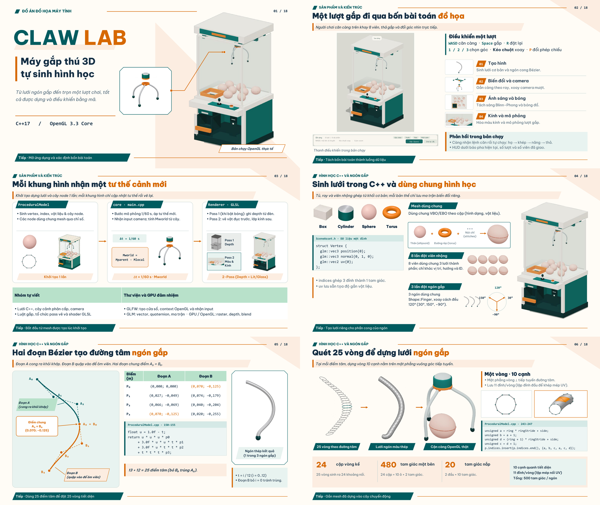
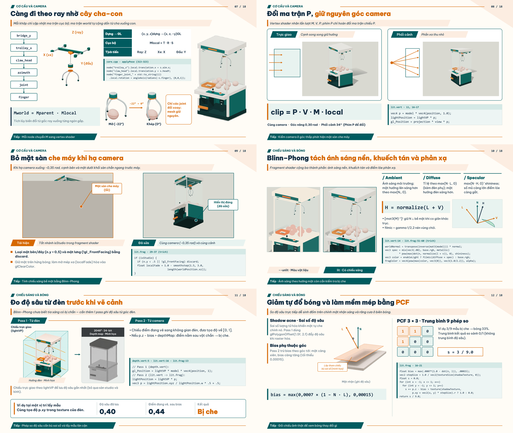
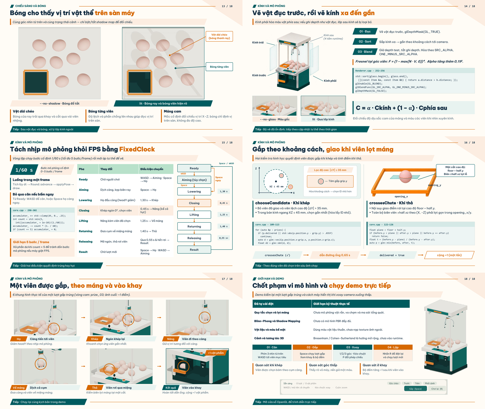

# Slide thuyết trình CLAW LAB

Bộ 18 slide bảo vệ đồ án Đồ họa máy tính (**CLAW LAB · C++17 / OpenGL 3.3 Core**), sử dụng ảnh chụp thực tế từ OpenGL runtime, mã nguồn trích dẫn trực tiếp và sơ đồ vector có thể chỉnh sửa hoàn toàn trong PowerPoint.

## Tải / xem nhanh

- **PowerPoint gốc (chỉnh sửa trực tiếp được):** [CLAW-LAB-Thuyet-trinh.pptx](CLAW-LAB-Thuyet-trinh.pptx)
- **Bản PDF (18 trang, xem trực tiếp trên GitHub):** [CLAW-LAB-Thuyet-trinh.pdf](CLAW-LAB-Thuyet-trinh.pdf)

## Phân công trình bày

| Phần | Slide | Nội dung chính |
| :--- | :---: | :--- |
| **Người 1** | `01 – 07` | Mở đầu, 4 bài toán, kiến trúc vòng lặp, sinh lưới `ProceduralModel`, Bézier 2 đoạn, quét 25 vòng và cây phân cấp cha–con |
| **Người 2** | `08 – 14` | Phép chiếu trực giao/phối cảnh, xử lý mặt sàn góc thấp (`isStudio`), Blinn–Phong, Depth Map 2 pass, PCF 3×3 và alpha blending kính |
| **Người 3** | `15 – 18` | `FixedClock` 1/60 s & máy trạng thái 8 pha, `chooseCandidate` / `crossesChute`, trace 6 pha gắp, phạm vi giới hạn & kịch bản demo |

> Nguồn file/dòng chi tiết và gợi ý lời dẫn của từng slide nằm trong phần **Speaker Notes** của file `.pptx`.

## Xem trước 18 slide

### Slide 01 – 06

### Slide 07 – 12

### Slide 13 – 18

